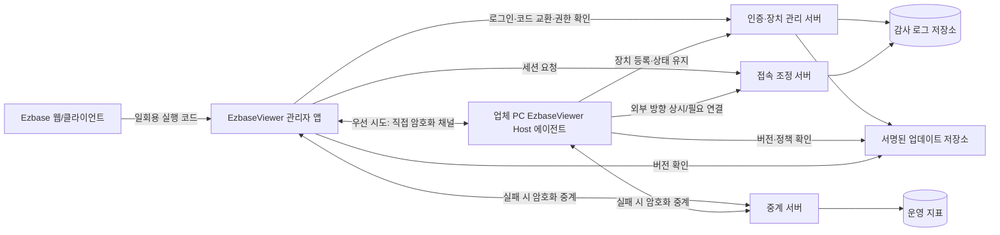
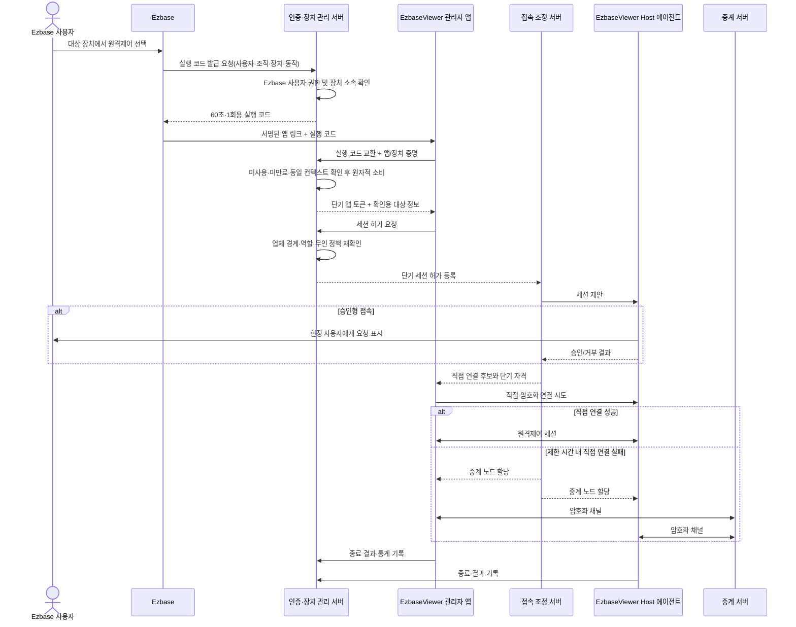
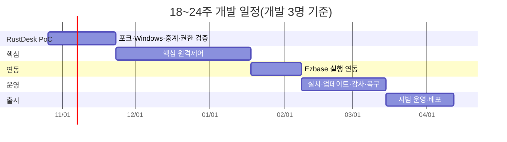

# EzbaseViewer 개발 계획

> 문서 상태: 개정안 v1.4
> 작성 기준일: 2026-10-21
> 적용 대상: Windows 간 원격제어, Ezbase에서 독립 앱 실행, 사내망·인터넷 접속
> 일정 기준: 전담 개발 3명(Windows 2명, 서버·Ezbase 연동 1명), QA·운영·보안 담당 부분 참여
> 기술 선정: RustDesk 확정, EzbaseViewer 자체 소스 공개, RustDesk 포크와 대응 소스는 AGPL-3.0 의무 적용

## 1. 문서 목적

본 문서는 `EzbaseViewer`라는 독립형 Windows 원격제어 제품을 개발하고 운영하기 위한 실행 계획이다. EzbaseViewer 관리자 앱은 권한이 있는 여러 업체와 업체별 관리 대상 PC를 조회·관리·접속한다. 대상 PC에는 TeamViewer Host와 같은 Host 전용 에이전트만 설치하며, Host에서는 다른 PC를 검색하거나 원격 접속을 시작할 수 없다.

REA(Reverse Engineer Anything)는 제품의 기반 엔진이 아니다. 공개 소스와 공식 문서만으로 확인하기 어려운 엔진 구조, Windows 세션 동작, 장애 원인 등을 합법적으로 분석할 때 사용하는 보조 도구다. 기능 지원 여부와 보안성은 REA 결과만으로 확정하지 않고 실제 Windows 시험과 라이선스·계약 검토를 함께 통과해야 한다.

## 2. 목표, 성공 기준 및 범위

### 2.1 목표

1. Ezbase 사용자가 별도 주소나 비밀번호를 입력하지 않고 권한이 있는 업체 PC에 원격 접속할 수 있게 한다.
2. 사내망에서는 가능한 경우 직접 연결하고, 직접 연결에 실패하면 자체 중계 서버를 통해 접속한다.
3. 일반 업체 PC에 수신 포트 개방이나 공유기 설정을 요구하지 않는다.
4. 승인형 일회성 접속과 등록 장치 무인 접속을 모두 지원한다.
5. 접속과 파일 전송의 주체·대상·시각·결과를 감사할 수 있게 한다.
6. 설치, 코드 서명, 업데이트, 장애 복구까지 포함해 시범 업체에게 운영 가능한 패키지를 제공한다.
7. EzbaseViewer 관리자 앱에서 업체별 클라이언트 목록, 온라인 상태, Host 버전, 무인 접속 정책과 접속 이력을 관리한다.
8. 클라이언트 설치 패키지는 Host 전용으로 고정하고 Viewer·관리 콘솔·대상 검색 기능을 포함하지 않는다.
9. EzbaseViewer 자체 개발 소스는 공개 저장소에서 개발·배포하고, 빌드 재현 정보와 제3자 고지를 함께 제공한다.

### 2.2 1차 출시 성공 기준

- EzbaseViewer 관리자 앱과 EzbaseViewer Host 에이전트가 지원 대상 Windows 버전에서 설치·실행된다.
- 화면 보기, 키보드·마우스 제어, 다중 모니터 선택, 파일 전송이 사내망과 인터넷 환경에서 동작한다.
- 승인형 일회성 접속, 등록 장치 무인 접속, 사용자 종료, 관리자 종료가 정책대로 동작한다.
- 직접 연결 실패 시 사용자의 재설정 없이 중계 연결로 전환된다.
- RustDesk 통합 PoC에서 UAC 보안 데스크톱, 로그온 화면, 사용자 세션 전환, 재부팅 후 재접속을 확인한다. 하나라도 충족하지 못하면 시범 배포로 진행하지 않고 포크 수정 범위와 일정을 재산정한다.
- 업체·조직 간 장치와 세션이 서버 측 권한 검사로 분리된다.
- 실행 코드의 만료·재사용·변조 및 권한 없는 사용자 요청이 거부된다.
- 프로그램의 실행 파일과 설치 패키지가 코드 서명되고, 업데이트 실패 시 이전 정상 버전으로 복구할 수 있다.
- 시범 운영 전에 확정한 동시 접속 수와 대역폭 목표로 부하시험을 통과한다.
- 관리자는 허용된 업체를 전환해 업체별 클라이언트 목록과 상태를 확인할 수 있고, 다른 업체의 클라이언트는 조회하거나 접속할 수 없다.
- Host 설치 결과가 서버에 `HostOnly`로 등록되며 대상 PC에서 원격 접속을 시작하는 기능이 노출되지 않는다.

### 2.3 범위

| 구분 | 포함 | 제외 |
|---|---|---|
| 클라이언트 OS | Windows 관리자 PC와 Windows 호스트 PC | 모바일, macOS, Linux 클라이언트 |
| 제품 역할 | 관리자용 EzbaseViewer 앱, 대상 PC용 EzbaseViewer Host 전용 에이전트 | Host에서 다른 PC 제어, 통합 Viewer/Host 겸용 앱 |
| 실행 방식 | Ezbase 버튼으로 서명된 독립 EzbaseViewer 관리자 앱 실행 | Ezbase 화면 안에 원격 화면 직접 임베딩 |
| 네트워크 | 사내 직접 연결, 인터넷 직접 연결, 자체 중계 | 일반 업체 PC 수신 포트 개방, 폐쇄망 완전 독립 운영 |
| 기능 | 1차 기능과 명시된 후속 기능 | TeamViewer 전체 기능과의 완전한 동등성 |
| 운영 | 인증·권한·감사·설치·서명·업데이트·복구 | 과금·사용량 청구 시스템 |
| 분석 | 공식 자료·공개 소스 우선, 승인된 대상의 REA 보조 분석 | 무단 분석, 인증·라이선스 우회, 타사 비밀 복제 |
| 소스 공개 | EzbaseViewer 자체 코드·문서·빌드 스크립트·공개 가능한 시험 코드 | 업체 정보, 인증키·서명키, 운영 비밀, 계약상 비공개 SDK·바이너리 |

### 2.4 공개·비공개 저장소 경계

| 구역 | 공개 여부 | 포함 내용 | 통제 |
|---|---|---|---|
| EzbaseViewer 제품 저장소 | 공개, Apache-2.0 | 중립 API 계약, 제어 서버, 시험·빌드 코드, 공개 문서 | 비공개 자료 반입 자동 검사와 코드 검토 |
| RustDesk 포크 | 공개, AGPL-3.0 | Viewer·HostOnly·Server 변경, 대응 소스, 빌드 방법 | 원 저작권·라이선스 고지와 변경 추적 |
| Ezbase 내부 연동 저장소 | 비공개 | 내부 API·DB·SSO 어댑터, 실제 식별자 매핑, 내부 배포 구성 | 승인된 개발·운영자만 접근하고 공개 저장소가 빌드 시 직접 참조하지 않음 |
| 비밀관리·감사 시스템 | 비공개 제한 | 운영 키·인증서·비밀번호, 업체·장치·사용자 데이터, 실제 로그·장애 자료 | Git 저장 금지, 최소권한, 접근 감사와 회전 |

Ezbase 내부용 API는 인터넷에 게시하지 않는다. 실제 연결 주소가 루프백·사설망·IPv6 ULA/링크 로컬 범위이고 서비스 인증도 성공한 요청만 허용한다. 운영 방화벽과 리버스 프록시는 외부 경로를 내부 API에 라우팅하지 않으며, 신뢰할 프록시 목록과 실제 허용 주소는 비공개 운영 구성에서 관리한다. 공개 저장소에는 내부 URL, DB 스키마, 접속 문자열, SSO 구현과 실제 필드 매핑을 포함하지 않는다.

## 3. 제품 구성과 책임

### 3.1 논리 구성도



### 3.2 구성요소별 책임

| 구성요소 | 주요 책임 | 저장·처리 정보 | 장애 시 원칙 |
|---|---|---|---|
| EzbaseViewer 관리자 앱 | 사용자 로그인, 허용 업체 전환, 업체별 클라이언트 목록·검색·상태·정책 관리, 실행 코드 교환, 원격 화면·입력, 파일 전송, 종료 | 단기 액세스 토큰, 허용 업체·클라이언트 메타데이터, 현재 세션 정보, 화면 데이터 | 인증·업체 권한 확인 실패 시 목록과 접속을 모두 금지. 화면 데이터는 기본적으로 로컬 저장 금지 |
| EzbaseViewer Host 에이전트 서비스 | 설치 시 업체·장치 등록, 부팅 시 시작, 장치 키 보관, 서버로 외부 방향 연결, 재부팅·로그온 전 지원, 업데이트·복구 | 업체 ID, 장치 개인키, `HostOnly` 설치 모드, 등록 상태, 정책 버전 | 서비스 장애를 감지해 제한 횟수 재시작. 손상 시 정상 버전 복구. 다른 PC 접속 시작 기능은 제공하지 않음 |
| Host 사용자 프로세스 | 현장 승인 UI, 연결 표시, 즉시 종료, 사용자 세션의 화면·입력 연계 | 승인 결과, 현장 표시 상태 | 서비스와 IPC 단절 시 원격 입력 중단 및 표시 종료 |
| 인증·장치 관리 서버 | 사용자 인증 연계, 조직·업체 권한, 장치 등록·철회, 무인 정책, 실행 코드, 세션 허가 | 사용자·조직·업체·장치·정책·세션 메타데이터 | 권한 판정 불가 시 거부. 업체 경계를 넘는 조회 금지 |
| 접속 조정 서버 | 관리자·호스트 매칭, 후보 경로 교환, 직접 연결 시도, 중계 할당 | 세션 ID, 단기 연결 자격, 경로 후보 | 직접 연결 실패 시 중계로 전환. 세션 허가 만료 시 폐기 |
| 중계 서버 | 양측 암호화 트래픽 전달, 연결량 측정, 속도·동시성 제한 | 연결 메타데이터와 운영 지표 | 응용 데이터 평문 저장 금지. 다른 중계 노드로 재시도 |
| 감사 로그 저장소 | 접속·종료·권한 변경·파일 전송 이력의 변경 방지 보관 | 행위자, 대상, 결과, 상관관계 ID | 기록 실패 정책에 따라 고위험 작업 거부 또는 별도 경보 |
| 업데이트 저장소 | 서명된 매니페스트·패키지 제공, 단계 배포, 롤백 | 버전, 해시, 서명, 배포 채널 | 서명·해시 불일치 시 설치 금지 |

### 3.3 Windows 프로세스 구조 원칙

Windows 서비스는 사용자 데스크톱과 직접 상호작용하도록 만들지 않는다. 서비스와 각 로그인 세션에서 실행되는 사용자 프로세스를 분리하고, ACL을 제한한 로컬 IPC로 통신한다. 호스트의 고권한 서비스는 장치 등록, 정책, 업데이트, 사용자 세션 프로세스 기동을 담당하고, 화면 표시와 현장 사용자 입력은 세션 프로세스가 담당한다.

UAC 보안 데스크톱과 로그온 화면은 일반 사용자 데스크톱 캡처와 다른 권한·세션 경계를 갖는다. 따라서 이를 제품 코드에서 나중에 보완할 항목으로 미루지 않고 엔진 선정 PoC의 탈락 조건으로 둔다.

### 3.4 업체별 관리 및 Host 전용 설치 원칙

- EzbaseViewer 관리자 앱의 최상위 탐색 단위는 `업체`이고, 업체 아래에 등록된 클라이언트 Host를 표시한다.
- 업체 선택 시 클라이언트 이름, 온라인 상태, 마지막 접속, Host 버전, Windows 정보, 무인 접속 허용 여부와 활성 세션을 조회한다.
- 관리자 계정은 명시적으로 부여된 업체만 볼 수 있다. 검색·목록·상세·세션·감사 API 모두 같은 업체 경계를 적용한다.
- Host 설치 프로그램은 업체용 1회성 등록 코드를 받아 해당 업체에 귀속한다. 설치 뒤 클라이언트는 항상 `HostOnly` 역할로 등록된다.
- Host UI는 설치 상태, 연결 요청 승인, 연결 중 표시, 즉시 종료, 버전·진단 정보만 제공한다.
- Host에는 업체 목록, 다른 클라이언트 목록, 주소 입력, 원격 접속 시작, 관리자 기능을 제공하지 않는다.
- 관리자 앱과 Host는 별도 실행 파일·설치 패키지·업데이트 채널로 관리한다.

## 4. 연결 및 세션 흐름

### 4.1 Ezbase에서 정상 접속



### 4.2 연결 상태 기계

`요청됨 → 권한검사 → 현장승인(해당 시) → 직접연결시도 → 중계연결시도 → 연결됨 → 재연결대기 → 종료됨`

- 권한검사, 현장승인, 직접연결, 중계연결에는 각각 제한 시간을 둔다.
- 명시적 종료, 현장 사용자 즉시 종료, 정책 철회, 장치 등록 해제는 `재연결대기`로 가지 않고 최종 종료한다.
- 네트워크 단절은 제한된 재연결 시간 동안 동일 세션 자격으로 재시도할 수 있다. 서버가 세션을 취소했거나 자격이 만료되면 새 허가를 받아야 한다.
- 재부팅 요청은 재부팅 사유와 요청자를 감사 기록한 뒤 세션을 `재부팅대기`로 전환한다. Host 서비스가 다시 온라인이 되면 기존 사용자에게만 새 단기 세션 자격을 발급한다.

### 4.3 네트워크 원칙

- 호스트는 인증·조정 서버 및 중계 서버로 외부 방향 연결을 시작한다.
- 관리·조정 API는 표준 TLS 포트 사용을 우선한다. 원격 데이터 경로에 필요한 정확한 포트와 프로토콜은 엔진 PoC에서 확정한다.
- 직접 연결 성공 여부는 NAT, 방화벽, 프록시 정책에 따라 달라지므로 직접 연결을 성공 조건으로 삼지 않는다. 중계 전환 성공까지 하나의 접속 성공으로 본다.
- 직접·중계 경로 모두 서버가 발급한 동일한 단기 세션 자격과 장치 신원 검증을 적용한다.
- 중계 서버는 트래픽 내용을 업무 로그로 남기지 않는다. 연결 ID, 양방향 바이트, 지연, 오류 코드 등 운영 메타데이터만 보관한다.

## 5. 기능 우선순위와 인수 조건

| 우선순위 | 기능 | 1차 인수 조건 |
|---|---|---|
| P0 | 화면 보기 | 단일·다중 모니터 환경에서 선택한 화면을 표시하고, 해상도 변경 후 세션을 유지한다 |
| P0 | 키보드·마우스 제어 | 한/영 입력, 조합 키, 드래그, 휠을 지원하며 보기 전용 정책에서는 입력을 거부한다 |
| P0 | 다중 모니터 선택 | 모니터 목록·해상도를 표시하고 개별 모니터 전환이 가능하다 |
| P0 | 승인형 일회성 접속 | 현장 사용자가 대상·요청자를 확인해 승인 또는 거부하며, 응답 제한 시간이 있다 |
| P0 | 등록 장치 무인 접속 | 업체·장치별 허용 정책과 사용자 역할을 모두 만족할 때만 승인 없이 연결된다 |
| P0 | 연결 표시·즉시 종료 | 호스트 화면에 원격 연결 상태를 계속 표시하고 현장 사용자가 한 동작으로 종료한다 |
| P0 | 직접·중계 연결 | 직접 연결 실패가 감지되면 별도 사용자 조치 없이 중계로 전환한다 |
| P0 | UAC·로그온 화면 | 권한 상승 프롬프트와 Windows 로그온 화면을 표시·제어하는 시험을 통과한다 |
| P0 | 재부팅 후 재접속 | 권한 있는 사용자가 재부팅을 요청하고 Host 서비스 재기동 후 동일 작업 흐름으로 복귀한다 |
| P1 | 파일 전송 | 업·다운로드, 진행·취소, 크기·정책 제한, SHA-256 무결성 확인, 감사 기록을 지원한다 |
| P1 | 설치·서명·업데이트 | 무인 설치 옵션, Authenticode 서명, 단계 배포, 실패 롤백을 지원한다 |
| P2 | 클립보드 | 텍스트부터 제공하고 파일·서식은 별도 위험 검토 후 확장한다 |
| P2 | 채팅 | 세션 참여자 간 텍스트 메시지와 감사 정책을 정의한다 |
| P2 | 원격 오디오 | 장치·개인정보 정책과 대역폭 영향을 확인한 뒤 제공한다 |
| P2 | 세션 녹화 | 고지·동의·보관·열람 권한과 저장 비용을 확정한 뒤 제공한다 |
| P2 | 장치 그룹·정책 | 그룹별 무인 접속, 파일 전송, 보기 전용, 시간대 정책을 중앙 관리한다 |

## 6. RustDesk 엔진 적용 계획

### 6.1 선정 결과

| 엔진 | 활용 방향 | 현재 확인 사항 | PoC에서 확인할 핵심 | 결정 |
|---|---|---|---|---|
| RustDesk Client + Server OSS | Windows Viewer·HostOnly 포크, 자체 `hbbs`·`hbbr` | Client `1.4.9`와 Server OSS `1.1.16`을 PoC 기준선으로 고정한다. 양쪽 공식 저장소는 AGPL-3.0이다 | UAC·로그온·재부팅, HostOnly 빌드, Ezbase 세션 허가 결합, 직접·중계, AGPL 대응 소스 제공 | 확정. 필수 게이트 통과 후 시범 배포 |

RealVNC, TightVNC, UltraVNC와 VncSharp는 구현 후보에서 제외한다. RustDesk 필수 게이트를 포크 수정으로도 충족하지 못하거나 유지보수가 중단되는 경우에만 대안을 재평가한다.

### 6.2 필수 게이트

다음 항목 중 하나라도 `불충족`이면 시범 배포를 중단하고 수정 범위·일정·보안 영향을 재승인한다.

1. EzbaseViewer 공개 라이선스와 호환되며 소스·고지·네트워크 제공 의무를 이행할 수 있는 조건
2. Windows UAC 보안 데스크톱 및 로그온 화면 제어
3. 서비스 시작과 재부팅 후 재접속
4. 직접 연결 실패 후 자체 또는 계약상 허용된 중계 경로 전환
5. 장치·세션 인증을 Ezbase 권한 체계와 결합할 수 있는 API 또는 수정 권한
6. 파일 전송·무인 접속을 정책으로 차단할 수 있는 제어점
7. 보안 패치와 지원 종료를 추적할 수 있는 유지보수 체계
8. 배포 바이너리의 코드 서명과 자동 업데이트 허용

### 6.3 평가표와 점수

| 평가 영역 | 가중치 | 측정 방법 |
|---|---:|---|
| Windows 핵심 기능 | 25 | UAC, 로그온, 다중 모니터, 재부팅, 서비스·사용자 세션 시험 |
| 연결 구조 | 15 | 사내 직접, 다른 인터넷 회선, NAT 실패, 중계, 프록시 시험 |
| 보안·권한 결합 | 15 | 외부 인증, 장치 키, 세션 자격, 무인 정책, 감사 후크 검토 |
| 임베딩·브랜딩 | 10 | UI/프로세스/설치 패키지 맞춤 가능 범위와 기술 검증 |
| 라이선스·배포 조건 | 15 | 공개 라이선스 호환성, 소스·고지 의무, 재배포 단위, 로열티·동시접속 비용 |
| 유지보수·지원 | 10 | 최근 릴리스, 보안 공지, LTS/SLA, 공급사 대응 시험 |
| 성능·품질 | 10 | 화질, 지연, CPU/GPU, 메모리, 세션당 대역폭, 장시간 안정성 |

각 항목을 0~5점으로 평가하고 `가중치 × 점수/5`로 계산한다. 점수는 엔진 재선정용이 아니라 RustDesk의 수정 우선순위와 잔여 위험을 정하는 데 사용한다. 필수 게이트는 총점으로 상쇄할 수 없다.

### 6.4 PoC 시험 패키지

- Windows 10 및 Windows 11의 회사 지원 에디션·패치 수준
- 관리자 PC 2대, 호스트 PC 4대 이상, 2개 인터넷 회선, 사내망, NAT·방화벽 제한 환경
- 표준 사용자와 관리자 사용자, 로그온 전 상태, 잠금 상태, 사용자 전환 상태
- 단일/다중 모니터, 서로 다른 DPI·해상도
- 1GB 단일 파일과 다수 소파일 전송, 전송 중 단절·취소
- 직접 연결 차단 후 중계 강제, 중계 노드 장애
- 재부팅·서비스 재시작·사용자 로그오프 후 복구
- 8시간 연속 세션과 반복 연결 100회

PoC마다 설치 파일, 설정, 정확한 버전, 라이선스 근거, 실행 로그, 패킷 메타데이터, 화면 녹화 또는 스크린샷, CPU·메모리·대역폭을 증거로 남긴다.

## 7. REA 활용 실행 절차

### 7.1 사용 원칙

- 분석 대상은 회사가 소유하거나 분석 권한을 확보한 파일, 공개 소스, 시험 빌드로 제한한다.
- 공식 문서와 공개 소스 분석을 먼저 수행한다. REA는 남은 질문을 좁혀 확인하는 데 사용한다.
- 라이선스 키, 인증, 사용량 제한, 코드 서명을 우회하는 조사나 구현은 수행하지 않는다.
- 관측 사실과 분석자의 추론을 분리하고, 모든 결론에 대상 버전·해시와 근거 위치를 붙인다.
- 결과는 실제 Windows 블랙박스 시험 또는 소스 수준 시험으로 재현해야 설계 근거로 채택한다.

### 7.2 환경 준비

1. 분석 전용 Windows x64 VM을 준비하고 스냅샷으로 초기화 가능하게 한다.
2. 공식 저장소와 npm 패키지의 현재 요구사항을 확인한다. 2026-10-21 확인 기준 REA 패키지는 Node.js `22.x(>=22.19)`, `24.x(>=24.11)` 또는 `26+`와 npm을 요구한다.
3. 공식 빠른 설치는 `npx rea-agents setup`이지만, 프로젝트 재현 환경에서는 승인된 정확한 버전으로 `npx rea-agents@<검증버전> setup`을 사용하고 버전·패키지 무결성 정보를 기록한다.
4. `rea --help`, 연결된 MCP 도구 목록, `doctor` 또는 공식 진단 절차로 실제 제공 기능을 확인한다. 설치 성공만으로 분석 제공자 사용 가능성을 판정하지 않는다.
5. JavaScript/Electron과 .NET 정적 분석은 대상과 도구 지원 범위가 맞을 때 우선 사용한다. 네이티브 바이너리 분석은 Ghidra·Hopper·IDA 등 승인된 제공자와 해당 라이선스가 필요하다.
6. Windows Ghidra 경로는 Ghidra·JDK와 REA의 Windows 지원 버전을 실제로 설치해 읽기 전용 작업을 검증한다. 특정 작업이 Windows에서 지원되지 않으면 승인된 Linux 분석 VM 또는 일반 Windows 진단 도구로 대체한다.
7. 버전 변경은 분석 배치 중간에 하지 않는다. 변경이 필요하면 같은 표본을 다시 분석해 결과 차이를 기록한다.

### 7.3 단계별 분석 질문

| 단계 | 질문 예시 | 기대 증거 | 결과가 쓰이는 곳 |
|---|---|---|---|
| 구성 식별 | Viewer, Host, Service, Relay 구성요소는 무엇인가 | 파일 목록, 서명, 모듈·임포트, 프로세스 트리 | 배포 구성, 공급망 목록 |
| Windows 서비스 | 서비스가 사용자 프로세스를 어떻게 기동하고 세션을 식별하는가 | 서비스 설정, IPC 명칭, 호출·문자열 참조 | 서비스/사용자 프로세스 설계 |
| 화면 캡처 | 사용 API와 코덱·변경 영역 처리 방식은 무엇인가 | 관련 모듈, API 참조, 런타임 지표 | 성능 PoC와 GPU 호환성 |
| 입력 주입 | 일반 데스크톱과 보안 데스크톱의 입력 경로가 다른가 | API 참조, 권한, 재현 시험 | UAC·로그온 게이트 |
| 연결 조정 | 직접 연결과 중계 선택 조건, 제한 시간, 오류 코드는 무엇인가 | 네트워크 캡처, 문자열, 상태 전이 | 조정 서버 및 UX |
| 인증·키 | 장치 신원·세션 키·인증서가 어디서 생성·보관되는가 | 구성·코드 참조, 저장 위치, 프로토콜 근거 | 위협 모델과 키 관리 |
| 재연결 | 단절·재부팅 후 어떤 자격과 상태를 재사용하는가 | 상태 저장, 호출 흐름, 시험 로그 | 재연결 보안 정책 |
| 파일 전송 | 경로 검증·무결성·재개·취소가 어떻게 처리되는가 | 메시지 형식, 해시, 파일 I/O 흐름 | 파일 정책과 시험 |

### 7.4 분석 작업 절차

1. **질문 등록:** 한 분석 작업에는 하나의 명확한 질문과 판정 기준을 둔다.
2. **대상 고정:** 파일 SHA-256, 제품 버전, 서명자, 획득 경로, 분석 권한을 기록한다.
3. **공식 근거 수집:** 공급사 문서, 소스 파일, 공개 이슈에서 답을 찾고 부족한 지점을 표시한다.
4. **최소 분석:** REA의 파일 인벤토리·정적 분석부터 시작하고 필요한 범위에서만 네이티브 제공자를 사용한다.
5. **근거 연결:** 함수·모듈·주소·문자열·네트워크 관측 등 재확인 가능한 위치를 보존한다.
6. **반증 시험:** 다른 설명이 가능한지 검토하고, 기능을 켜고 끈 두 실행을 비교한다.
7. **Windows 재현:** 지원 대상 Windows에서 동일 동작을 블랙박스 시험한다.
8. **결론 등급:** `확인`, `강한 추정`, `미확인`, `반증` 중 하나로 기록한다.
9. **설계 반영:** 확인된 결론만 ADR(Architecture Decision Record), 구현 작업, 시험 케이스로 전환한다.

### 7.5 REA 분석 기록 양식

```text
분석 ID:
분석 질문:
업무 목적/허가 근거:
대상 제품·버전:
대상 파일 및 SHA-256:
REA·분석 제공자 버전:
실행 환경:
사용한 도구/명령(비밀정보 제거):
공식 문서·소스 근거:
관측 사실:
추론:
반대 가능성/제약:
Windows 재현 절차와 결과:
결론 등급:
설계/시험 반영 항목:
검토자·검토일:
```

분석 원본에는 업체 정보나 인증 토큰을 넣지 않는다. 명령 출력에 비밀정보가 포함되면 접근 제한 저장소에 보관하고, 개발 문서에는 마스킹한 증거만 연결한다.

## 8. Ezbase 연동 설계

### 8.1 선행 확인 항목

Ezbase 담당자가 1단계 2주차까지 다음 내용을 서면으로 제공해야 한다.

- Ezbase 형태(웹, 데스크톱, 하이브리드)와 버튼 실행 방식
- 사용자 인증 방식, 로그인 세션, 사용자·조직·업체 식별자의 안정성
- 장치 목록과 업체 소유 관계의 기준 시스템
- 서버 측 확장 API, 웹훅, 사용자 권한 조회 가능 여부
- 사용자 브라우저에서 사용자 지정 URI 스킴 또는 로컬 앱 런처 사용 가능 여부
- 앱 미설치 시 설치 페이지 이동 방식과 브라우저별 제한
- 개발·검증 환경, 테스트 계정, 장애 연락 창구

호출 규격은 이 정보가 확인되기 전까지 제안 상태다. 구현팀이 임의로 URI, 필드명, 인증 방식을 확정하지 않는다.

### 8.2 권장 실행 방식

1. 사용자가 Ezbase에서 장치를 선택하고 원격제어 버튼을 누른다.
2. Ezbase 백엔드가 현재 로그인 사용자와 대상 장치를 이용해 서버 간 인증으로 실행 코드를 발급받는다.
3. Ezbase는 `ezbaseviewer://launch?code=<opaque-code>` 형태의 사용자 지정 URI 또는 검증된 로컬 런처 방식으로 EzbaseViewer 관리자 앱을 실행한다.
4. 앱은 실행 코드를 백엔드와 교환한다. URL에는 사용자 ID, 장치 ID, 비밀번호, 액세스·리프레시 토큰을 넣지 않는다.
5. 서버는 코드를 원자적으로 소비하고 앱에 단기 토큰과 사람이 확인할 대상 이름을 돌려준다.
6. 앱은 세션 개설 직전에 권한과 장치 정책을 다시 확인한다.

URI는 브라우저 기록·운영체제 로그에 남을 수 있으므로 실행 코드는 충분한 엔트로피를 가진 불투명 난수로 만들고 서버에는 해시만 저장한다. 초기 유효기간은 60초, 사용 횟수는 1회다. 실제 유효기간은 사용자 경험과 공격 재현 시험 후 보안 담당자가 확정한다.

### 8.3 제안 API

| API | 호출자 | 최소 입력 | 최소 출력 | 통제 |
|---|---|---|---|---|
| `POST /v1/launch-codes` | Ezbase 백엔드 | 사용자·조직·업체·장치 ID, 요청 동작, nonce | 실행 코드, 만료 시각 | 서버 간 인증, 권한 검사, 1회성 난수 |
| `POST /v1/launch-codes/exchange` | EzbaseViewer 관리자 앱 | 실행 코드, 앱 인스턴스 ID, 앱 버전 | 단기 앱 토큰, 대상 표시 정보, 허용 동작 | 원자적 소비, 60초 만료, 재사용 탐지 |
| `POST /v1/companies` | Ezbase/운영 백엔드 | 업체 ID, 표시 이름 | 업체 정보 | 내부 인증, 업체 ID 중복 방지 |
| `GET /v1/companies` | EzbaseViewer 관리자 앱 | 사용자 권한 문맥 | 허용 업체와 클라이언트 수 | 업체 목록 권한 필터 |
| `GET /v1/companies/{companyId}/clients` | EzbaseViewer 관리자 앱 | 업체 ID, 검색·상태 조건 | 업체별 클라이언트 Host 목록 | 업체 접근 권한, 페이지 제한 |
| `POST /v1/clients/enrollments` | Host 설치 프로그램 | 업체용 등록 코드, 장치 공개키, 장치 속성 | 장치 ID, `HostOnly`, 인증서/등록 결과 | 등록 코드 1회성, 업체 결합, 역할 고정 |
| `POST /v1/sessions` | EzbaseViewer 관리자 앱 | 대상 장치, 접속 유형, 요청 기능 | 세션 ID, 승인 상태 | 사용자·업체·장치·무인 정책 재검사 |
| `POST /v1/sessions/{id}/authorize` | 호스트/정책 서버 | 승인 또는 거부, 사유 | 세션 자격 또는 거부 결과 | 호스트 장치 인증, 제한 시간 |
| `POST /v1/sessions/{id}/terminate` | EzbaseViewer 관리자 앱/호스트/운영자 | 종료 사유 | 종료 확인 | 참여자 또는 권한 있는 운영자만 가능 |
| `POST /v1/audit-events` | 신뢰된 구성요소 | 이벤트 유형, 상관관계 ID, 결과, 메타데이터 | 수신 ID | 스키마 검증, 중복 방지, 비밀정보 차단 |

모든 ID는 추측하기 어려운 값으로 사용하되, 난수 ID 자체를 권한으로 취급하지 않는다. 모든 리소스 접근 시 서버가 조직·업체 경계를 다시 적용한다.

### 8.4 핵심 데이터 개체

- `Organization`: Ezbase 계약 또는 운영 조직
- `Company`: 조직 안의 데이터·권한 격리 단위
- `User`: Ezbase의 안정된 사용자 식별자와 상태
- `RoleBinding`: 사용자·그룹이 업체와 장치에 대해 가진 동작 권한
- `ManagedClient`: 업체 소속, 공개키, `HostOnly` 역할, 등록·철회 상태, Host 버전, 온라인 상태, 마지막 접속
- `UnattendedPolicy`: 무인 접속 허용 여부, 허용 역할·시간·기능
- `LaunchCode`: 코드 해시, 사용자·조직·업체·장치·동작 결합, 만료, 소비 시각
- `Session`: 요청자, 대상, 승인 유형, 경로, 시작·종료·결과
- `FileTransfer`: 세션, 방향, 파일명 정책값, 크기, 해시, 결과
- `AuditEvent`: 행위자, 대상, 이벤트, 시각, 결과, IP·앱·장치 버전, 상관관계 ID

### 8.5 오류 처리와 사용자 안내

| 상황 | 앱 동작 | 서버·감사 동작 |
|---|---|---|
| 앱 미설치 | 서명된 공식 설치 페이지 안내 | 실행 실패 지표만 기록. 코드에는 비밀정보가 없도록 유지 |
| 코드 만료 | Ezbase에서 다시 실행하도록 안내 | `launch_code_expired` 기록 |
| 코드 재사용 | 접속 금지, 일반 오류 안내 | 고위험 보안 이벤트와 요청 문맥 기록 |
| 권한 없음 | 업체 정보나 정책 상세를 노출하지 않고 거부 | 사용자·대상·판정 정책 버전 기록 |
| 장치 오프라인 | 마지막 접속 시각과 재시도 선택 표시 | 오프라인 결과 기록 |
| 현장 사용자 거부/시간 초과 | 거부 또는 시간 초과를 명확히 표시 | 승인 결과와 소요시간 기록 |
| 직접 연결 실패 | 중계로 자동 전환하며 상태 표시 | 실패 분류와 선택된 중계 노드 기록 |
| 중계 실패 | 제한 횟수 재시도 후 지원용 오류 ID 표시 | 내부 상세 오류와 상관관계 ID 기록 |

## 9. 보안 설계와 운영 통제

### 9.1 인증·권한

- Ezbase 사용자는 기존 인증을 재사용하되, 원격제어 백엔드는 서명된 서버 간 요청 또는 표준 토큰의 발급자·수신자·만료·서명을 독립적으로 검증한다.
- 장치는 설치 시 생성한 비내보내기 우선 개인키와 서버가 승인한 신원으로 인증한다. 장치 등록 코드만으로 장기 신원을 대신하지 않는다.
- 기본 역할은 `원격 보기`, `원격 제어`, `파일 전송`, `무인 접속 관리`, `장치 관리`, `감사 조회`, `운영 관리`로 분리한다.
- 권한은 조직 → 업체 → 장치 범위로 좁아지며, 업체 간 권한 상속은 허용하지 않는다.
- 무인 접속은 기본 비활성화한다. 업체 정책과 장치 정책, 사용자 역할이 모두 허용할 때만 활성화한다.
- 장치 등록 해제, 사용자 비활성화, 무인 정책 철회 시 새 접속을 즉시 차단하고 활성 세션 종료 여부를 정책에 따라 실행한다.

### 9.2 세션과 암호화

- 관리 API는 지원되는 최신 TLS 정책을 사용한다. 구체적 TLS 버전·암호군은 조직 보안 기준과 엔진 기능 검증 후 확정한다.
- 원격 데이터 경로는 직접·중계 여부와 무관하게 종단 또는 이에 준하는 강도의 세션 암호화를 적용한다. 중계 사업자/운영자가 화면·입력·파일 평문에 접근할 수 있는지는 엔진 평가표에 명시한다.
- 세션 자격은 단일 세션·단일 관리자·단일 호스트에 결합하고 짧은 시간만 유효하게 한다.
- 화면 보기, 입력 제어, 파일 전송 권한을 세션 기능 단위로 표현해 서버와 양쪽 앱에서 함께 적용한다.
- 명시적 종료 뒤 같은 자격으로 재연결하지 못하게 한다.

### 9.3 호스트 안전장치

- 접속 중에는 호스트에 요청자와 연결 상태를 계속 표시한다. 업체 정책이 허용한 무인 장치에서도 시스템 트레이 또는 지정된 표시 정책을 적용한다.
- 현장 사용자의 즉시 종료는 서버 응답을 기다리지 않고 로컬 입력·화면 전송을 먼저 중지한다.
- 파일 전송은 허용 경로, 파일 크기, 확장자 또는 악성코드 검사 정책을 적용한다. 호스트 경로 순회와 심볼릭 링크 우회 시험을 포함한다.
- EzbaseViewer 관리자 앱의 클립보드와 파일 드래그앤드롭은 1차 범위에서 암묵적으로 활성화하지 않는다.

### 9.4 감사 기록

필수 이벤트는 로그인 결과, 실행 코드 발급·교환·실패, 장치 등록·철회, 권한·정책 변경, 세션 요청·승인·경로·시작·종료, 현장 종료, 재부팅, 파일 전송 요청·완료·실패, 업데이트 결과다.

- 기록에는 UTC 시각, 행위자, 조직·업체, 대상 장치, 결과, 사유 코드, 앱·에이전트 버전, 세션/상관관계 ID를 포함한다.
- 실행 코드, 액세스 토큰, 장치 개인키, 파일 내용, 화면 내용은 기록하지 않는다.
- 파일명은 개인정보 정책에 따라 원문 또는 제한된 표현을 선택하고, 파일 내용은 감사 저장소에 복제하지 않는다.
- 감사 로그는 일반 운영자도 수정하지 못하는 별도 권한과 보존 정책을 적용한다.
- 보존 기간, 열람 승인, 내보내기 형식은 시범 운영 전 개인정보·보안 담당자가 확정한다.

## 10. 설치, 서명, 업데이트 및 복구

### 10.1 설치

- EzbaseViewer 관리자 앱과 EzbaseViewer Host 에이전트를 별도 패키지로 제공한다.
- 호스트 설치는 서비스 등록, 업체·장치 등록, 방화벽·프록시 확인, 제거 보호 정책을 포함한다.
- 설치·업데이트 로그는 비밀정보를 제거하고 지원용 상관관계 ID를 제공한다.
- 일반 사용자 설치와 중앙 배포 도구 사용 시나리오를 각각 시험한다.

### 10.2 코드 서명

- 실행 파일, DLL, 서비스, 설치 패키지, 업데이트 매니페스트를 승인된 인증서로 서명한다.
- Windows Authenticode에는 SHA-256 파일 다이제스트와 RFC 3161 SHA-256 타임스탬프를 사용한다.
- 서명 키는 개인 PC나 CI 파일로 두지 않고 접근 통제된 서명 서비스 또는 하드웨어 보호 키에 보관한다.
- CI는 서명 전·후 해시, 서명자, 타임스탬프, 검증 결과를 릴리스 증거로 보관한다.

### 10.3 업데이트와 복구

- 업데이트 채널을 개발, 사내 검증, 시범 업체, 일반 배포로 분리한다.
- 에이전트는 서명된 매니페스트와 패키지 해시·서명을 모두 검증한다.
- 시범 그룹부터 단계적으로 확대하고, 오류율·서비스 미기동률이 기준을 넘으면 자동 중단한다.
- 새 버전을 별도 위치에 준비한 뒤 원자적으로 전환하고, 기동 확인 실패 시 이전 정상 버전으로 되돌린다.
- 서버 API와 구·신 클라이언트의 호환 기간을 최소 한 개 배포 주기 유지한다.
- 긴급 철회 목록을 제공해 취약 버전의 신규 접속을 차단하되, 복구 업데이트 경로는 유지한다.

## 11. 개발 단계와 상세 WBS

전체 일정은 18~24주 추정치다. 엔진 공급사 계약, Ezbase 자료·테스트 환경 제공, 코드 서명 인증서 발급 지연은 일정 외부 의존성으로 따로 관리한다.

### 11.1 1단계: RustDesk 통합 개념검증(3~4주)

| 작업 | 주담당 | 선행 조건 | 산출물 | 완료 조건 |
|---|---|---|---|---|
| 요구사항·시험 추적표 확정 | 기술 책임자, QA | 본 계획 승인 | 요구사항 추적표, PoC 시험서 | 모든 P0 요구가 시험 ID와 연결됨 |
| RustDesk 공식 자료·라이선스 조사 | 서버 개발, 법무/구매 | ADR-0001 | AGPL 의무·저장소 경계 검토서 | Apache 제어 서버와 AGPL 포크의 결합·배포 의무가 서면으로 확인됨 |
| 공개 저장소 운영 기준 확정 | 기술 책임자, 보안, 법무 | 저작권 주체 확인 | LICENSE, NOTICE, CONTRIBUTING, SECURITY, 제3자 고지 정책 | 최초 외부 공개 전에 승인된 라이선스와 비밀정보 차단 절차가 적용됨 |
| REA 환경·분석 기록 체계 준비 | Windows 개발 A | 분석 권한, 시험 VM | 버전 고정 기록, 분석 템플릿 | 승인된 표본에서 재현 가능한 결과 생성 |
| RustDesk Windows PoC | Windows 개발 2명 | Client 1.4.9 소스·빌드 환경 | Viewer·HostOnly 시험 빌드, 시험 증거 | 필수 게이트 결과가 모두 판정됨 |
| 연결·중계 PoC | 서버 개발 | 시험 네트워크 | 경로 전환 로그, 지표 | 직접 실패 후 중계 접속 성공 |
| 통합 아키텍처 승인 | 기술 책임자, 보안, 법무, 제품 책임자 | PoC 결과 | ADR 보완, 통합·라이선스 결정서 | RustDesk 수정 범위와 잔여 위험 승인 |

**중단 조건:** RustDesk가 UAC·로그온, 재부팅, 자체 중계 또는 AGPL 배포 의무를 충족하지 못하면 2단계로 진행하지 않는다. 포크 수정 또는 대체 엔진 재평가의 비용·기간을 별도 승인한다.

### 11.2 2단계: 핵심 원격제어(6~8주)

| 작업 | 주담당 | 선행 조건 | 산출물 | 완료 조건 |
|---|---|---|---|---|
| EzbaseViewer 관리자 앱 기본 셸·로그인 | Windows 개발 A | 엔진 선정, 인증 계약 | 서명 전 개발 빌드 | 로그인·로그아웃·오류 처리가 동작 |
| Host 서비스·사용자 프로세스 | Windows 개발 B | 엔진 선정 | 서비스, IPC, 현장 UI | 부팅·로그온·사용자 전환 시험 통과 |
| 조직·업체·장치·역할 모델 | 서버 개발 | Ezbase 식별자 초안 | DB 스키마, 관리 API | 업체 간 접근 격리 시험 통과 |
| 장치 등록·철회 | Windows B, 서버 | 장치 신원 설계 | 등록 흐름, 키 저장 | 코드 재사용·다른 업체 등록 거부 |
| 화면·입력·모니터 | Windows 2명 | 엔진 어댑터 | 핵심 제어 기능 | 기능별 P0 시험 통과 |
| 승인형·무인 접속 | 전원 | 정책 모델 | 승인 UI, 정책 API | 승인·거부·철회·시간초과 통과 |
| 직접·중계 경로 | 서버, Windows A | 조정 서버 | 세션 조정·중계 배포 | 네트워크 매트릭스 통과 |
| 파일 전송·감사 | Windows A, 서버 | 세션 권한 | 전송 UI/API, 감사 이벤트 | 무결성·권한·중단 시험 통과 |
| 재부팅·재접속 | Windows B, 서버 | Host 서비스 | 상태·재개 흐름 | 로그온 전 복귀 및 종료 정책 통과 |

이 단계부터 암호화, 업체 경계, 정책, 감사 이벤트를 실제 구현한다. 운영 단계까지 미루지 않는다.

### 11.3 3단계: Ezbase 실행 연동(2~3주)

| 작업 | 주담당 | 선행 조건 | 산출물 | 완료 조건 |
|---|---|---|---|---|
| Ezbase 기술 인터페이스 확정 | 서버 개발, Ezbase 담당 | 선행 정보 제공 | 호출 계약서, 예외 목록 | 양측 담당자 서면 승인 |
| 실행 코드 발급·교환 | 서버 개발 | 계약 확정 | API, 원자적 소비 저장 | 만료·재사용·변조 동시성 시험 통과 |
| URI/런처 등록과 앱 실행 | Windows A | 실행 방식 확정 | 프로토콜 등록, 설치 안내 | 지원 브라우저·Ezbase 환경 통과 |
| 대상 확인·세션 연결 | Windows A, 서버 | 코드 교환 | 확인 UI, 세션 요청 | 다른 장치 치환 공격 시험 통과 |
| 오류 UX·감사 | Windows B, QA | 오류 코드 정의 | 안내 문구, 감사 이벤트 | 미설치·오프라인·권한 거부 통과 |

### 11.4 4단계: 운영 기능(4~5주)

| 작업 | 주담당 | 선행 조건 | 산출물 | 완료 조건 |
|---|---|---|---|---|
| 설치·제거·코드 서명 | Windows B, 운영 | 인증서·릴리스 절차 | 서명 패키지, 검증 로그 | 깨끗한 PC 설치·업그레이드·제거 통과 |
| 자동 업데이트·롤백 | Windows B, 서버 | 저장소·서명 키 | 업데이트 서비스, 매니페스트 | 전원/네트워크 중단 후 복구 통과 |
| 감사 조회·내보내기 | 서버 개발 | 보존·권한 정책 | 검색 API/UI 또는 운영 도구 | 업체 격리·무결성·내보내기 통과 |
| 정책 철회·긴급 차단 | 서버, Windows A | 정책 모델 | 철회 전파, 버전 차단 | 목표 시간 내 신규·활성 세션 차단 |
| 서버 감시·경보 | 서버 개발, 운영 | 운영 플랫폼 | 대시보드, 경보, 런북 | 모의 장애가 탐지·통보됨 |
| 백업·복구·키 교체 | 서버, 보안, 운영 | 인프라 확정 | 복구 절차, 훈련 기록 | 목표 복구 시간 내 복원 성공 |

### 11.5 5단계: 시범 운영·배포(3~4주)

| 작업 | 주담당 | 선행 조건 | 산출물 | 완료 조건 |
|---|---|---|---|---|
| 용량 목표 확정 | 제품 책임자, 운영 | 시범 업체 정보 | 장치·동접·대역폭 목표 | 부하시험 입력값 승인 |
| 부하·안정성·보안 시험 | QA, 서버, 보안 | 릴리스 후보 | 결과서, 결함 목록 | 승인 기준 충족, 치명 결함 0건 |
| 시범 업체 배포 | 운영, 지원 | 배포 승인 | 설치 현황, 지원 기록 | 정한 기간의 성공률·안정성 충족 |
| 장애 대응 훈련 | 운영, 개발 | 런북 | 훈련 보고서 | 탐지·완화·복구·사후 기록 수행 |
| 운영 인수·출시 | 제품 책임자, 운영 | 전체 증거 | 인수서, 배포 패키지, 릴리스 노트 | 운영·보안·제품 책임자 승인 |

## 12. 일정과 인력 운용



위 날짜는 계획 설명을 위한 최장 24주 예시이며 실제 착수일 승인 후 기준선을 다시 만든다. 엔진 계약과 Ezbase 인터페이스 확인을 1단계에서 병행한다. 개발자 3명에게 모든 역할을 겹쳐 배정하지 않도록 QA 회귀 시험과 운영 자동화는 부분 참여 인력을 확보한다.

| 역할 | 주 책임 | 주요 승인 |
|---|---|---|
| 제품 책임자 | 범위, 우선순위, 시범 업체, 출시 | 기능 범위, 용량 목표, 출시 |
| 기술 책임자/Windows A | 전체 아키텍처, EzbaseViewer 관리자 앱, 엔진 어댑터 | 엔진 선정, ADR, 릴리스 기술 승인 |
| Windows B | Host 서비스, 세션 프로세스, 설치·업데이트 | UAC·재부팅·복구 증거 |
| 서버·연동 개발 | 인증·장치·세션·조정·중계·Ezbase API | API 계약, 업체 격리, 운영 지표 |
| QA(부분 참여) | 시험 설계, 추적, 회귀, 출시 판정 | 시험 결과와 결함 종료 |
| 보안·개인정보(부분 참여) | 위협 모델, 권한·암호화·감사·보존 | 보안 게이트, 예외 승인 |
| 운영·지원(부분 참여) | 배포, 감시, 백업·복구, 업체 지원 | 운영 인수, 장애 런북 |
| 법무·구매(부분 참여) | 제품 공개 라이선스, 엔진·오픈소스·상용 계약 | 저작권 주체, 라이선스 호환성, 재배포·고지 조건 |

## 13. 시험 및 검증 계획

### 13.1 시험 기록 필드

모든 시험은 `시험 ID, 요구사항 ID, 환경·버전, 사전 조건, 입력 데이터, 수행 절차, 기대 결과, 실제 결과, 증거 링크, 통과 여부, 결함 ID, 수행자·일시`를 기록한다.

### 13.2 핵심 인수 시험

| ID | 분류 | 시나리오 | 기대 결과 |
|---|---|---|---|
| CON-01 | 연결 | 같은 사내망의 관리자·호스트 | 권한 확인 후 직접 연결되고 경로가 기록됨 |
| CON-02 | 연결 | 서로 다른 인터넷 회선 | 직접 또는 중계로 연결되고 수신 포트 설정을 요구하지 않음 |
| CON-03 | 연결 | 직접 연결용 경로 차단 | 제한 시간 후 중계로 자동 전환됨 |
| CON-04 | 연결 | 연결 중 네트워크 30초 단절 | 정책 시간 안에 재연결하거나 명확히 종료됨. 중복 세션 없음 |
| CON-05 | 연결 | 사용자가 명시적으로 종료 후 네트워크 복구 | 자동 재접속하지 않음 |
| WIN-01 | Windows | 단일·다중 모니터 선택·전환 | 올바른 화면과 좌표로 표시·입력됨 |
| WIN-02 | Windows | UAC 보안 데스크톱 표시·입력 | 화면이 보이고 허용된 입력이 동작함 |
| WIN-03 | Windows | 로그온·잠금 화면 | 정책에 맞게 표시·제어됨 |
| WIN-04 | Windows | 사용자 전환·로그오프 | 대상 세션을 잘못 제어하지 않고 상태가 갱신됨 |
| WIN-05 | Windows | 재부팅 요청 | 감사 기록 후 재부팅, 서비스 기동, 제한 시간 내 재접속 가능 |
| FIL-01 | 파일 | 1GB 파일 업·다운로드 | SHA-256 일치, 크기·결과 감사 기록 |
| FIL-02 | 파일 | 전송 중 단절·취소 | 부분 파일 정책대로 정리 또는 재개, 완료로 오기록하지 않음 |
| FIL-03 | 파일 | 금지 경로·경로 순회 | 서버·호스트가 거부하고 보안 이벤트 기록 |
| AUT-01 | 인증 | 60초가 지난 실행 코드 | 교환 거부 및 만료 이벤트 기록 |
| AUT-02 | 인증 | 같은 코드 동시 2회 교환 | 정확히 한 요청만 성공 |
| AUT-03 | 인증 | 코드의 장치·사용자 문맥 변경 | 접속 거부, 실제 대상 정보 미노출 |
| AUT-04 | 권한 | 권한 없는 사용자 | 세션 생성 이전에 거부 |
| AUT-05 | 격리 | 업체 A 사용자가 업체 B 장치 ID 사용 | 모든 조회·접속·감사 API에서 거부 |
| POL-01 | 정책 | 무인 접속 허용 후 정책 철회 | 새 무인 접속 거부, 활성 세션은 확정 정책대로 종료 |
| POL-02 | 현장 통제 | 현장 사용자가 즉시 종료 | 로컬에서 즉시 화면·입력 중단, 재접속 차단 |
| OPS-01 | 설치 | 깨끗한 지원 Windows에 설치·제거 | 서비스·URI·파일이 정확히 생성·제거됨 |
| OPS-02 | 서명 | 패키지 변조 후 설치 | 서명·해시 검증 실패로 설치 거부 |
| OPS-03 | 업데이트 | 다운로드·전환 중 전원/네트워크 중단 | 현재 또는 이전 정상 버전으로 기동 |
| OPS-04 | 서버 | 중계 노드 1대 중단 | 신규 세션이 정상 노드로 배정되고 경보 발생 |
| AUD-01 | 감사 | 감사 수집기 일시 장애 | 정책대로 버퍼·재전송되며 중복 없이 수집됨 |
| SEC-01 | 로그 | 정상·실패 흐름 로그 검사 | 토큰·코드·개인키·파일 내용이 기록되지 않음 |

### 13.3 비기능 시험

- 지연: 직접·중계 각각 키·마우스 입력 왕복 지연과 화면 갱신 지연을 측정한다.
- 자원: EzbaseViewer 관리자 앱과 EzbaseViewer Host 에이전트의 유휴·접속·파일 전송 중 CPU, GPU, 메모리를 측정한다.
- 대역폭: 정지 화면, 문서 작업, 동영상 움직임에서 해상도별 평균·95백분위 값을 측정한다.
- 안정성: 8시간 연속 세션, 반복 연결 100회, 네트워크 플랩, 서비스 강제 종료 후 복구를 수행한다.
- 호환성: 지원 Windows 버전, DPI, 다중 모니터, 프록시, 백신·EDR 대표 환경을 매트릭스로 관리한다.
- 보안: 위협 모델 검토, 인증·권한 API 시험, 설치·업데이트 공급망 시험, 외부 침투 시험을 출시 전에 수행한다.

## 14. 용량 계획과 부하시험

### 14.1 시범 운영 전 확정할 입력값

| 항목 | 기호 | 확정 책임자 | 확정 시점 |
|---|---|---|---|
| 등록 장치 수 | `D` | 제품 책임자 | 4단계 종료 전 |
| 최대 동시 접속 수 | `C` | 제품 책임자·운영 | 4단계 종료 전 |
| 중계 사용 비율 | `R` | 기술 책임자 | PoC 측정 후 |
| 중계 세션 평균/95백분위 대역폭 | `Bavg`, `B95` | QA·서버 개발 | 성능 PoC 후 |
| 목표 여유율 | `H` | 운영 | 부하시험 계획 승인 시 |
| 감사 이벤트 초당 최대량 | `E` | 서버 개발 | 통합시험 후 |

### 14.2 계산 기준

- 예상 동시 중계 세션: `C_relay = C × R`
- 중계 서버 최소 양방향 처리량: `T = C_relay × B95 × 2 × (1 + H)`
- 실제 서버 수는 노드 1대 장애 후에도 `T`를 처리하도록 N+1 이상으로 산정한다.
- 조정·인증 서버는 로그인 폭주, 장치 heartbeat, 세션 생성, 감사 이벤트를 분리해 부하시험한다.
- 화면 트래픽의 평균값만 사용하지 않고 95백분위와 동시 피크를 사용한다.

공식 문서의 예시 대역폭은 초기 인프라 견적 참고값으로만 사용하고, 채택 엔진과 실제 업체 화면 패턴으로 다시 측정한다.

## 15. 운영 지표, 경보 및 런북

### 15.1 핵심 지표

- 실행 코드 발급·교환 성공률, 만료·재사용 거부 건수
- 장치 온라인 비율, 버전 분포, 등록·철회 처리 시간
- 세션 요청·승인·연결 성공률, 직접/중계 비율, 연결 설정 시간
- 중계 노드별 동시 연결, 처리량, 오류율, CPU·메모리·네트워크
- 비정상 종료·재연결률, 재부팅 후 복귀 시간
- 파일 전송 성공률·바이트·무결성 실패
- 감사 이벤트 지연·실패·재전송 큐
- 업데이트 성공·실패·롤백률, 서비스 미기동률

### 15.2 필수 런북

1. 인증·장치 관리 서버 장애
2. 접속 조정 서버 장애
3. 중계 노드 과부하·장애
4. 인증서·서명 키 노출 의심
5. 취약 버전 긴급 차단·업데이트
6. 업체 간 권한 노출 의심
7. 감사 로그 수집 지연·유실 의심
8. 호스트 업데이트 후 서비스 미기동
9. Ezbase 실행 코드 발급 장애
10. 개인정보 또는 파일 전송 사고 대응

각 런북에는 탐지 조건, 초기 확인, 영향 범위, 완화, 복구, 업체 안내 책임, 증거 보존, 사후 검토 항목을 둔다.

## 16. 위험과 대응

| 위험 | 영향 | 조기 신호 | 대응/우회 |
|---|---|---|---|
| 엔진이 UAC·로그온을 안정적으로 지원하지 않음 | 1차 출시 불가 | PoC의 보안 데스크톱 실패 | 필수 게이트로 조기 탈락, 예비 상용 SDK 병행 평가 |
| 제품 라이선스와 엔진 라이선스가 충돌 | 공개·재배포 중단 | AGPL/GPL 또는 비공개 SDK 결합 범위 불명확 | 결합 전 법무 서면 검토, 호환 구조 채택 또는 다른 엔진 선택 |
| 공개 저장소에 비밀·업체 정보 유출 | 보안·개인정보 사고 | 커밋 검사에서 키·운영 로그 발견 | 비밀 탐지, 보호 브랜치, 공개 전 이력 검사, 즉시 폐기·회전 절차 |
| 외부 취약점 제보 처리 지연 | 실제 공격 위험 증가 | SECURITY 채널 미응답·수정 SLA 초과 | 비공개 제보 채널, 심각도별 SLA, 수정 후 공지와 CVE 절차 |
| Ezbase 기술 정보 지연 | 연동 일정 지연 | 1단계 2주차 자료 미제공 | 제안 API로 mock 개발, 의존성 일정 별도 보고 |
| 직접 연결 성공률 저조 | 중계 비용·지연 증가 | PoC 중계 비율 상승 | 중계 용량 재산정, 지역/다중 노드, 연결 알고리즘 튜닝 |
| 중계 트래픽 급증 | 비용·서비스 장애 | 95백분위 대역폭 초과 | 할당량·경보·자동 확장, 품질 적응, N+1 |
| 고권한 호스트 취약점 | 업체 PC 침해 | 서비스 IPC·업데이트 결함 | 최소 권한, IPC ACL, 서명 업데이트, 외부 보안시험 |
| 업데이트 실패 | 대규모 접속 불가 | 시범 그룹 서비스 미기동 | 단계 배포, 자동 중단, A/B 또는 이전 버전 롤백 |
| 업체 간 권한 누출 | 중대 보안 사고 | 경계 우회 시험 실패 | 모든 서버 조회에 업체 조건 강제, 자동 격리 시험 |
| 감사 기록 과다/민감정보 포함 | 비용·개인정보 위험 | 로그 샘플에 토큰·파일명 노출 | 스키마 허용 목록, 마스킹, 보존·접근 정책 |
| REA 분석을 확정 사실로 오인 | 잘못된 설계 결정 | 근거 없이 추론이 ADR로 이동 | 결론 등급, 동료 검토, Windows 재현을 의무화 |

## 17. 미확정 사항과 결정 시점

| 항목 | 현재 기본값/상태 | 확정 책임자 | 결정 시점/근거 |
|---|---|---|---|
| 원격제어 엔진·구현 언어 | RustDesk 확정; 포크는 Rust·Flutter 기반 upstream 구조 추종 | 기술 책임자·제품·법무·보안 | 확정, 기준 버전 변경 시 ADR 갱신 |
| 지원 Windows 상세 버전 | Windows 10/11 후보 | 제품 책임자 | PoC 시작 전, 업체 설치 현황 |
| Ezbase 실행 규격 | 사용자 지정 URI 제안 | Ezbase·서버 개발 | 1단계 2주차, 기술 인터페이스 |
| 실행 코드 유효기간 | 60초 제안 | 보안·제품 | 3단계, 보안·UX 시험 |
| 네트워크 포트·프로토콜 | TLS 기반 우선, 상세 미정 | 기술 책임자·인프라 | 엔진 선정 직후 |
| 감사 보존 기간 | 미정 | 보안·개인정보·제품 | 시범 운영 전 |
| 활성 세션 정책 철회 방식 | 즉시 종료 권장 | 제품·보안 | 2단계 정책 설계 시 |
| 등록 장치·동접·대역폭 | 미정 | 제품·운영 | 4단계 종료 전 |
| 중계 지역·노드 수 | 미정 | 운영 | 부하시험 계획 시 |
| 상용 SDK 예산·계약 | 유료 허용 | 제품·구매·법무 | 1단계 종료 전 |
| 제품 공개 라이선스 | Apache-2.0 적용, 저작권 표시 `EzbaseViewer contributors` | 제품·법무 | 권리관계 변경 시 재검토 |
| 공개 저장소 위치·관리자 | `https://github.com/hinosisi/EzbaseViewer`, 관리자 `hinosisi` | 기술 책임자·운영 | 확정, 관리자 변경 시 재검토 |
| 파일 크기·경로·확장자 정책 | 미정 | 제품·보안 | 2단계 파일 기능 착수 전 |
| 장애 복구 목표(RTO/RPO) | 미정 | 운영·제품 | 4단계 복구 설계 전 |

## 18. 요구사항 추적 요약

| 요구사항 | 설계/작업 | 시험 |
|---|---|---|
| EzbaseViewer 관리자 앱·호스트·인증/장치·조정/중계 | 3장, 11장 | CON, WIN, OPS 계열 |
| 화면·입력·다중 모니터 | 5장, 11.2 | WIN-01 등 기능 회귀 |
| 파일 전송 | 5장, 9.3 | FIL-01~03 |
| 승인형·무인 접속 | 4장, 5장, 9.1 | AUT, POL 계열 |
| 연결 종료·재부팅 후 재접속 | 4.2, 11.2 | CON-05, WIN-05 |
| UAC·로그온 필수 검증 | 3.3, 6.2 | WIN-02~04 |
| 직접 실패 후 자체 중계 | 4장, 6장 | CON-02~03, OPS-04 |
| 업체 PC 수신 포트 불필요 | 4.3 | CON-02 |
| 사용자·장치·업체 권한 | 8장, 9.1 | AUT-04~05, POL-01 |
| 표시·즉시 종료·암호화·감사 | 9장 | POL-02, AUD-01, SEC-01 |
| 설치·서명·업데이트·복구 | 10장, 11.4 | OPS-01~03 |
| 엔진 비교·VncSharp 참고 분류 | 6장 | PoC 추적표 |
| REA 보조 사용 | 7장 | 분석 기록·Windows 재현 증거 |
| Ezbase 일회용 실행 코드 | 8장 | AUT-01~03 |
| 단계별 개발·완료 조건 | 11~12장 | 단계별 게이트 승인 |
| 부하 입력값 추후 확정 | 14장, 17장 | 승인된 부하시험 결과 |
| 후속 기능 분리 | 5장 P2 | 후속 릴리스 계획에서 정의 |

## 19. 단계별 승인 게이트

| 게이트 | 승인에 필요한 증거 | 승인자 |
|---|---|---|
| G0 공개 준비 | 저작권 주체, 승인된 LICENSE·NOTICE, 기여·보안 정책, 비밀정보 이력 검사 | 제품·기술·보안·법무 |
| G1 RustDesk PoC 승인 | 필수 게이트, AGPL 경계 검토, PoC 증거, ADR | 기술·제품·보안·법무 |
| G2 핵심 기능 완료 | P0/P1 통합시험, 업체 격리, 감사, 알려진 결함과 대응 | 기술·QA·제품 |
| G3 Ezbase 연동 완료 | 호출 계약, 실행 코드 보안시험, 오류 UX, 양측 통합시험 | Ezbase·기술·보안 |
| G4 운영 준비 | 서명 패키지, 업데이트·롤백, 감시, 백업·복구 훈련 | 운영·보안·기술 |
| G5 시범 출시 | 부하·안정성·보안 결과, 치명 결함 0건, 운영 인수 | 제품·운영·보안 |

## 20. 공식 근거 및 확인 기록

아래 자료는 2026-10-21에 확인했다. 실제 PoC 착수 시 최신 릴리스와 계약 조건을 다시 확인한다.

- [REA 공식 저장소](https://github.com/morluto/rea): MCP/CLI 기반 분석 범위, Node.js 요구사항, 공식 설치·업데이트 경로, 증거 중심 분석 원칙.
- [REA 설치 문서](https://github.com/morluto/rea/blob/main/docs/installation.md): 에이전트 등록, 진단, 분석 제공자 및 Windows Ghidra 관련 조건.
- [REA Windows 네이티브 제어 문서](https://github.com/morluto/rea/blob/main/native/windows/README.md): Windows x64 네이티브 모듈과 검증 경계.
- [RustDesk Server OSS 공식 문서](https://rustdesk.com/docs/en/self-host/rustdesk-server-oss/): `hbbs` ID/조정 서버와 `hbbr` 중계 서버 구성.
- [RustDesk 클라이언트 설정 공식 문서](https://rustdesk.com/docs/en/self-host/client-configuration/): 자체 서버, 공개키, Pro API 및 맞춤 클라이언트 범위.
- [RustDesk 클라이언트 라이선스](https://github.com/rustdesk/rustdesk/blob/master/LICENCE): AGPL-3.0 라이선스 본문. 제품 적용 전 법무 검토 필요.
- [RustDesk Client 공식 릴리스](https://github.com/rustdesk/rustdesk/releases): PoC Client `1.4.9` 기준선과 릴리스 자산.
- [RustDesk Server OSS 공식 릴리스](https://github.com/rustdesk/rustdesk-server/releases): PoC Server `1.1.16` 기준선과 `hbbs`·`hbbr` 자산.
- [RustDesk Windows MSI 문서](https://rustdesk.com/docs/en/client/windows/msi/): Host 무인 설치·업데이트 패키징 검증 근거.
- [Apache License 2.0 공식 안내](https://www.apache.org/legal/apply-license): `LICENSE`와 `NOTICE` 적용 방식. EzbaseViewer 공개 라이선스 우선안의 근거이며 저작권 주체 승인 후 적용한다.
- [OSI 승인 라이선스 목록](https://opensource.org/licenses): 공개 라이선스 식별과 검토 기준.
- [Microsoft Interactive Services](https://learn.microsoft.com/en-us/windows/desktop/services/interactive-services): Windows 서비스와 사용자 세션 UI를 분리해야 하는 설계 근거.
- [Microsoft SignTool](https://learn.microsoft.com/en-us/windows/desktop/seccrypto/signtool): Windows 실행 파일의 서명·검증·타임스탬프 도구.
- [Microsoft Authenticode 타임스탬프 지침](https://learn.microsoft.com/en-us/windows/win32/seccrypto/time-stamping-authenticode-signatures): SHA-256과 RFC 3161 타임스탬프 권장 근거.

---

### 부록 A. RustDesk PoC 평가 기록 양식

```text
RustDesk Client/Server 버전·커밋:
공급사/저장소:
평가 라이선스·계약 근거:
배포 방식:
필수 게이트 결과(각 항목 증거 링크):
Windows 기능 점수/근거:
연결 구조 점수/근거:
보안·권한 결합 점수/근거:
임베딩·브랜딩 점수/근거:
라이선스·배포 조건 점수/근거:
유지보수·지원 점수/근거:
성능·품질 점수/근거:
총점:
비용 가정:
미해결 위험:
결론(통과/수정 후 재시험/시범 배포 중단):
검토자·승인자·일자:
```

### 부록 B. 출시 체크리스트

- [x] RustDesk 엔진 선정 ADR 승인
- [ ] RustDesk 필수 Windows·중계 게이트와 AGPL 검토 완료
- [ ] 저작권 주체와 공개 라이선스 확정, LICENSE·NOTICE 포함
- [ ] CONTRIBUTING·SECURITY·제3자 고지와 비밀정보 검사 완료
- [ ] 지원 Windows 버전과 설치 권한 정의
- [ ] Ezbase 호출 계약 및 사용자·조직·업체·장치 식별자 확정
- [ ] 직접·중계, 단절·재접속, UAC·로그온, 재부팅 시험 통과
- [ ] 실행 코드 만료·재사용·변조와 업체 간 접근 시험 통과
- [ ] 무인 접속 기본값·철회·현장 종료 정책 통과
- [ ] 파일 전송 무결성·경로·크기·감사 시험 통과
- [ ] 서명·타임스탬프·업데이트·롤백 시험 통과
- [ ] 감사 보존·접근·내보내기 정책 승인
- [ ] 등록 장치·동접·대역폭 목표와 N+1 부하시험 통과
- [ ] 감시·경보·백업·복구·긴급 차단 런북 훈련 완료
- [ ] 치명 결함 0건, 잔여 위험의 책임자·기한 승인
- [ ] 운영·지원 담당 인수와 시범 업체 안내 완료
