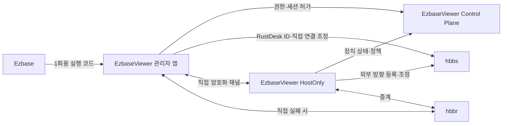

# RustDesk 통합 설계 기준

## 기준 버전

| 구성요소 | PoC 기준 | 사용 원칙 |
|---|---|---|
| RustDesk Client | `1.4.9`, commit `6c57829` | Windows x64 소스 빌드, Viewer와 HostOnly 프로필 분리 |
| RustDesk Server OSS | `1.1.16`, commit `73523b3` | Linux 컨테이너의 `hbbs`·`hbbr` 자체 운영 우선 |
| EzbaseViewer Control Plane | 현재 `main` | 업체·사용자·장치·세션 권한과 감사의 최종 판정자 |

다운로드한 소스와 바이너리는 태그·커밋·SHA-256·서명 또는 공급 경로를 기록하고 시험 증거에 첨부한다.

## 연결 구조

## 식별자와 권한 결합

- `ManagedClient.DeviceId`와 RustDesk 장치 ID를 일대일로 매핑한다.
- RustDesk 장치 ID만으로 세션을 열지 않는다. EzbaseViewer의 단기 세션 허가가 먼저 발급되어야 한다.
- 단기 허가는 사용자·조직·업체·장치·기능·만료시각과 RustDesk 연결 대상에 결합한다.
- 정책 철회, 현장 종료 또는 업체 경계 위반 시 RustDesk 세션도 종료하고 자동 재접속을 차단한다.
- 영구 RustDesk 비밀번호를 Ezbase 실행 링크나 관리자 앱 저장소에 전달하지 않는다.

## HostOnly 빌드

- 설치형 Windows 서비스와 사용자 세션 프로세스를 사용한다.
- 다른 장치 ID 입력, 최근 접속 대상, 주소록과 외부 접속 시작 UI를 제거한다.
- 현장 승인, 연결 표시, 즉시 종료, 진단과 버전 정보만 노출한다.
- ID Server, Relay Server와 공개키는 서명된 배포 설정으로 고정한다.
- upstream 자동 업데이트를 그대로 활성화하지 않고 EzbaseViewer 서명·단계 배포·롤백 절차를 사용한다.

## 서버 운영

- PoC는 `hbbs`와 `hbbr`를 격리된 자체 인프라에 배치한다.
- 공식 기본 포트를 출발점으로 삼되 실제 공개 포트, 역방향 프록시와 방화벽 규칙은 PoC에서 확정한다.
- WebSocket 기능을 사용하지 않으면 관련 포트를 닫는다. 사용할 경우 신뢰 가능한 역방향 프록시만 접근하게 제한한다.
- `hbbs` 공개키와 개인키의 생성·백업·회전·복구 절차를 문서화한다.
- `hbbr`의 동시 세션, 양방향 바이트, 지연과 오류를 측정해 용량 산정에 사용한다.

## 포크와 upstream 관리

1. RustDesk 클라이언트와 서버 포크를 현재 Apache 저장소와 분리한다.
2. upstream 태그에서 추적 브랜치를 만들고 EzbaseViewer 변경을 작은 커밋으로 유지한다.
3. 매 릴리스마다 upstream 보안·기능 변경을 검토하고 재기반 결과를 자동 시험한다.
4. AGPL-3.0 원문, 원 저작권 고지, 포크 소스와 재현 가능한 빌드 방법을 배포물에서 접근 가능하게 한다.
